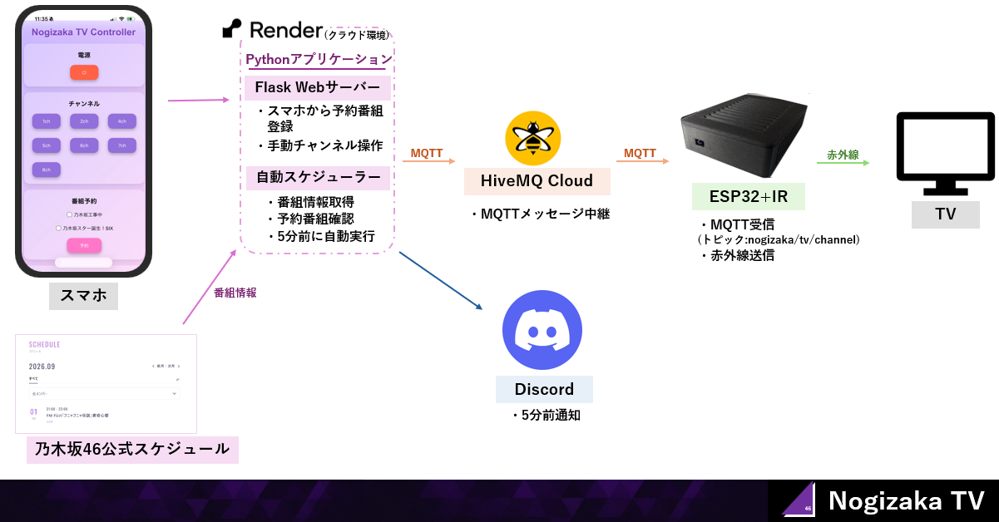
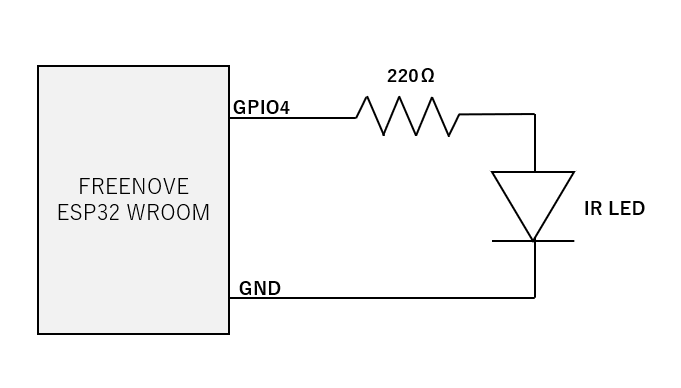
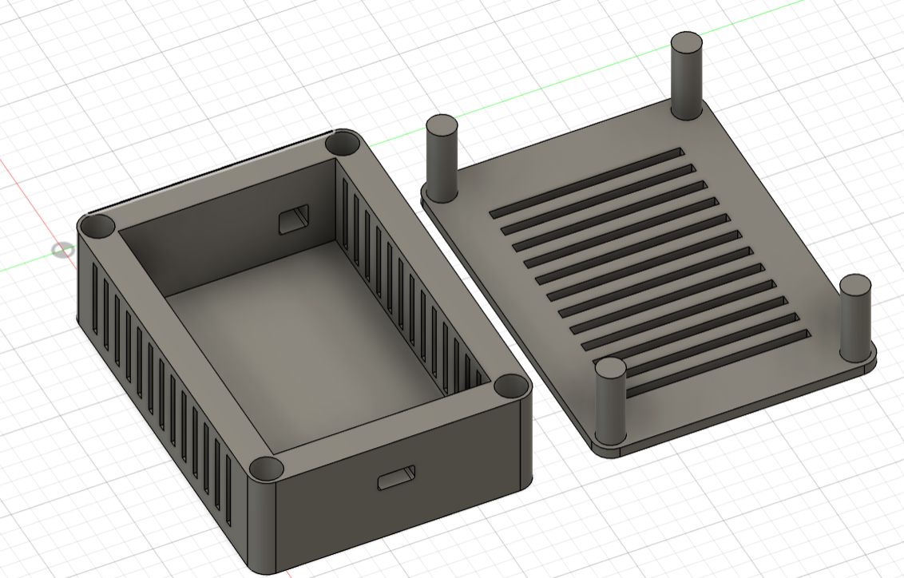
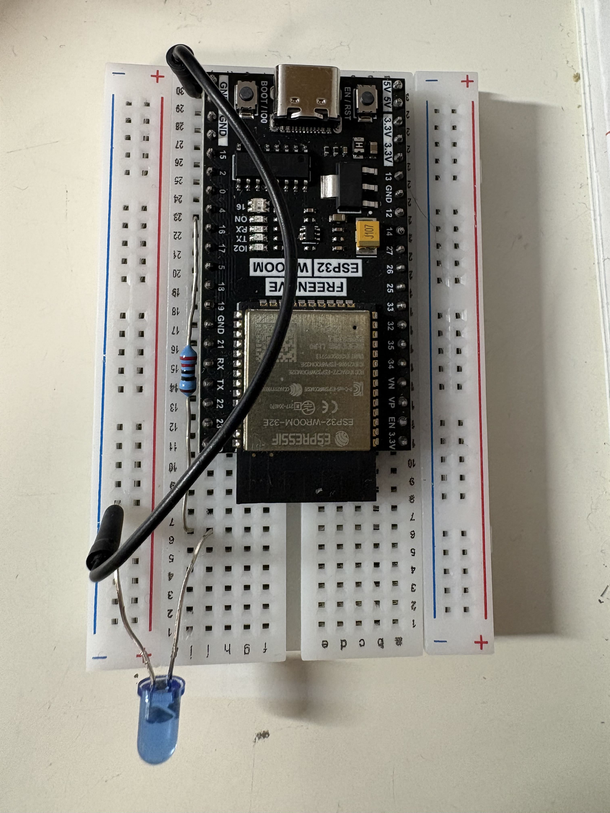
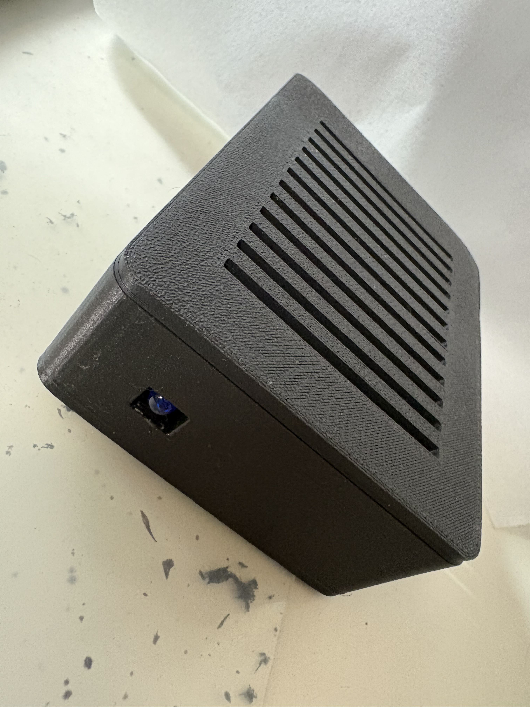
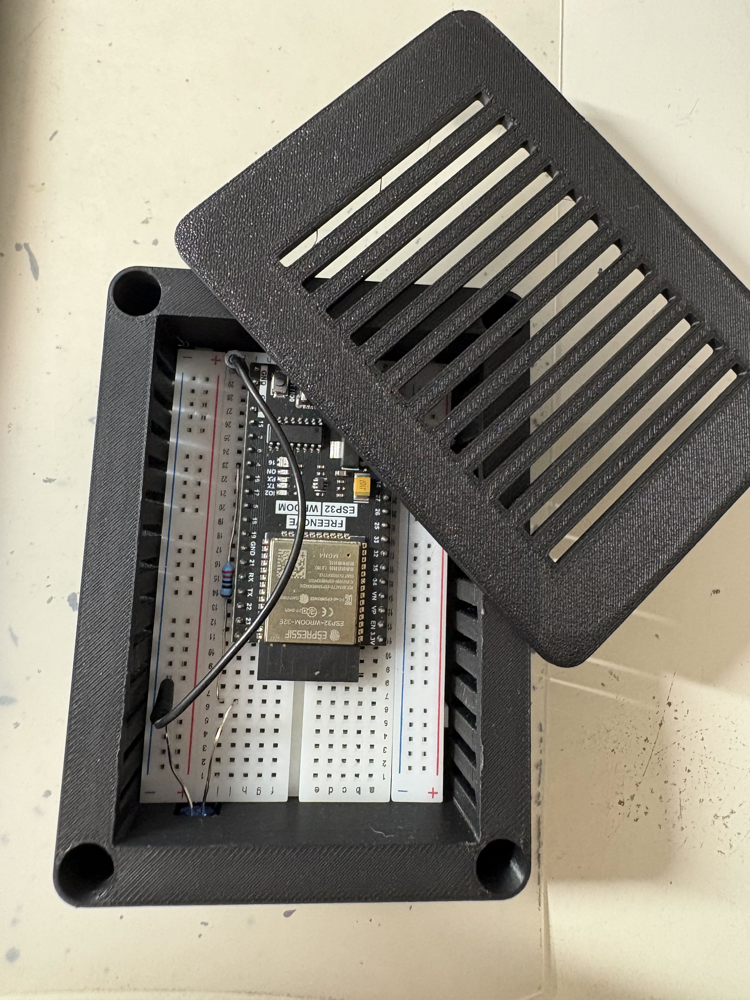
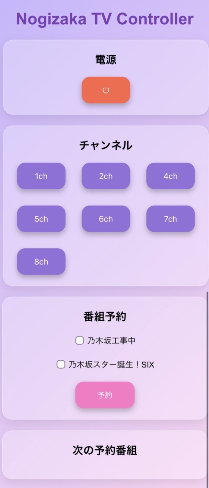
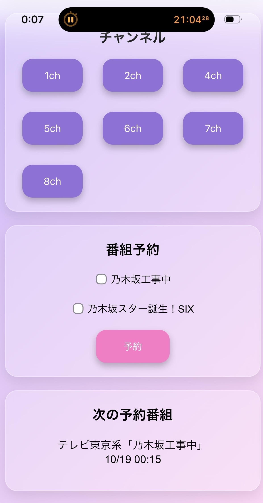
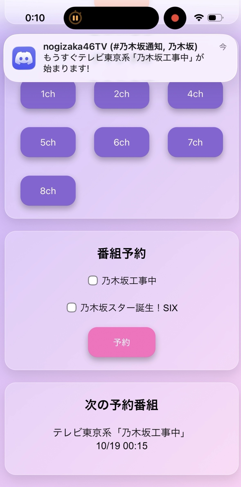

# NogizakaTV

乃木坂46のテレビ番組を自動予約し、
番組開始5分前にDiscordで通知するとともに、
ESP32を利用してテレビのチャンネルを自動的に変更するIoTシステムです。

スマートフォンからWebブラウザで番組を予約することができ、
Python・Flask・MQTT・ESP32・赤外線通信を組み合わせて
テレビを自動制御します。

---

## 目的

乃木坂46の番組を見逃さないために、
番組開始前の通知からテレビのチャンネル変更までを
自動化することを目的として制作しました。

PCを常時起動するのではなく、
クラウド上のWebアプリケーションとESP32を
MQTTで接続する構成にしています。

---

## 主な機能

-  スマートフォンからテレビを操作
-  スマートフォンからテレビのチャンネルを変更
-  乃木坂46公式スケジュールから番組情報を取得
-  番組開始5分前にDiscord通知
-  MQTTによるESP32へのチャンネル番号送信
-  ESP32からIR信号を送信
-  予約した番組の開始5分前にテレビのチャンネルを自動変更
-  RenderによるWebアプリケーション公開
-  ESP32・ブレッドボード・配線を収納する3Dプリントケース

---

## テレビ操作

スマートフォンのWeb画面からチャンネルを選択すると、
ESP32を経由してテレビのチャンネルを変更できます。

また、番組を予約しておくことで、
番組開始5分前に自動的にチャンネルを変更できます。

---

## システム構成

NogizakaTVのシステム構成を以下に示します。

---

## 回路図

ESP32のGPIO4から220Ωの抵抗を介して赤外線LEDを駆動し、テレビへ赤外線信号を送信します。

---

## 使用部品

| 部品 | 個数 | 用途 |
|---|---:|---|
| ESP32 | 1 | MQTT受信・IR送信 |
| IR LED | 1 | テレビへの赤外線送信 |
| 抵抗 | 1 | IR LEDの電流制限 |
| ブレッドボード | 1 | 回路の製作 |
| ジャンパーワイヤ | 数本 | 配線 |
| USBケーブル | 1 | 電源・書き込み |
| 3Dプリントケース | 1 | 本体の収納 |

---

## 使用技術

### ソフトウェア

- Python
- Flask
- MQTT
- HiveMQ Cloud
- Discord Webhook
- BeautifulSoup

### ハードウェア

- ESP32
- IR LED
- ブレッドボード
- 3Dプリンター
- Fusion 360

---

## 3Dプリントケース

ESP32、ブレッドボード、配線をまとめて収納するため、Fusion 360でケースを設計しました。

完成した装置とケースに収納した状態の写真は、以下に掲載しています。

<table>
  <tr>
    <td align="center">
      
       ケースに収納した状態
    </td>
    <td align="center">
      
       ケースに収納した状態（開封時）
    </td>
  </tr>
</table>

---

## 工夫した点

### 24時を超える番組時刻への対応

番組表では `24:15` や `25:29` のように、
24時を超えた時刻で番組が表示される場合があります。

そこで24時間を超えた時刻を翌日の時刻として処理しています。

### MQTTによる通信

PythonからESP32へ直接通信するのではなく、
HiveMQ Cloudを経由してチャンネル番号を送信しています。

### クラウド上での動作

Renderを利用することで、
PCを常時起動しなくてもスマートフォンから
Webアプリケーションを利用できるようにしました。

---

## 苦労した点

- 番組スケジュールAPIの解析
- `24:15` や `25:29` など24時を超える時刻への対応
- MQTT接続の安定化
- Discord Webhookの設定
- Renderへのデプロイ
- 番組の重複実行防止
- 予約番組だけを実行する処理

---

## 動作確認

<table>
  <tr>
    <td align="center" width="50%">
      <strong>1. 手動チャンネル切り替え</strong>  
      <a href="docs/Manual Channel Switching.mp4">
        動画を見る
      </a>
       
      
        スマートフォンのWeb UIからチャンネルを選択し、
        テレビのチャンネルが切り替わる様子
      
    </td>
    <td align="center" width="50%">
      <strong>2. 予約番組の自動切り替え</strong>  
      <a href="docs/Scheduled Channel Switching.mp4">
        動画を見る
      </a>
       
      
        番組開始5分前のDiscord通知と、
        予約番組への自動チャンネル切り替えの様子
      
    </td>
  </tr>
</table>

番組開始5分前にDiscordへ通知を送り、MQTTを経由してESP32へ
チャンネル番号を送信します。ESP32は対応する赤外線信号を
テレビへ送信し、チャンネルを切り替えます。

### アプリ画面

<table>
  <tr>
    <td align="center" width="33%" valign="bottom">
      
    </td>
    <td align="center" width="33%" valign="bottom">
      
    </td>
    <td align="center" width="33%" valign="bottom">
      
    </td>
  </tr>
  <tr>
    <td align="center">
      通常画面
    </td>
    <td align="center">
      番組予約後
    </td>
    <td align="center">
      Discord通知
    </td>
  </tr>
</table>

---

## Author

RUNA YAMAUCHI
